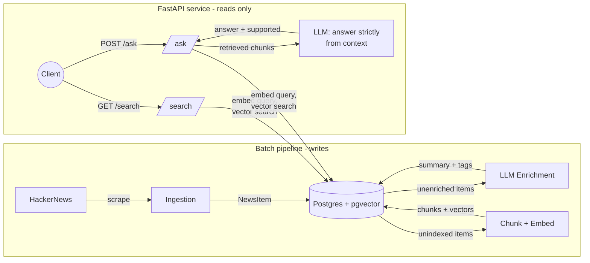
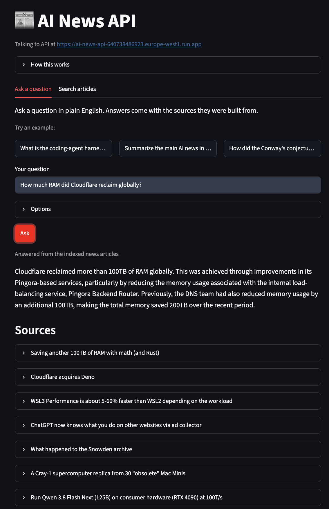

# AI News API

A retrieval-augmented generation (RAG) API over a corpus of scraped AI/tech
news. It answers natural-language questions grounded strictly in what it
actually retrieved — if the evidence doesn't support a confident answer, it
says so instead of guessing. Semantic search, structured LLM output, and
per-IP rate limiting are all backed by a full test suite and a CI pipeline
that runs on every push.

**Live demo:** https://ai-news-api.streamlit.app/ (free hosting: after inactivity the app sleeps, click the wake-up button on the page)

**Live API:** https://ai-news-api-640738486923.europe-west1.run.app/docs

[](https://github.com/Ehsan-Ghoreishi/ai-news-api/actions/workflows/ci.yml)

## Why this is interesting

Ask most LLMs a question about a recent event and you get either a
confident-sounding hallucination or a flat "my knowledge cutoff is...".
This project takes the other approach: retrieve real, indexed articles
first, force the model to answer *only* from what was retrieved, and make
the "I don't know" path a first-class response instead of something the
model has to be begged into. The `supported` flag on every answer, and the
fact that citations are only ever returned when `supported` is `true`, is
the whole design in miniature — the API is built to make an unsourced guess hard to mistake for a grounded fact.

## Architecture



The batch pipeline (`app/pipeline.py`: ingestion → enrichment → indexing)
**writes** to Postgres. The FastAPI service **only reads** from it — it
never scrapes or calls the enrichment agent during a request. `POST /ask/`
is the only route that calls an LLM at request time, and only to synthesize
an answer from chunks that were already retrieved by vector search.

| Layer | Code | Responsibility |
|---|---|---|
| Scraping | `app/scrapers/` | Fetch external data, return `NewsItem` objects |
| LLM calls | `app/agents/` | Embeddings, enrichment, grounded answering — nothing else touches OpenAI |
| Workflows | `app/services/` | `ingestion.py`, `enrichment.py`, `indexing.py` |
| Storage | `app/database/` | SQLAlchemy models, connection, repository (read/write) |
| API | `app/api/routes/` | `health`, `news`, `search`, `ask` — HTTP only, read-only |
| Schema | `app/schemas/news.py` | The one canonical `NewsItem`, shared everywhere |

## Tech stack

- **API:** FastAPI, Pydantic, Uvicorn
- **LLM:** OpenAI API (`text-embedding-3-small` for embeddings, `gpt-4o-mini`
  with structured outputs for grounded answering)
- **Storage:** PostgreSQL + [pgvector](https://github.com/pgvector/pgvector)
  via SQLAlchemy
- **Rate limiting:** slowapi (per-client-IP token bucket)
- **Quality:** pytest + pytest-cov (unit tests, mocked LLM/DB), mypy (strict
  typing), ruff (lint + format)
- **CI/CD:** GitHub Actions, Docker, Google Cloud Run

## How to run locally

Requires Python 3.11+, [uv](https://docs.astral.sh/uv/), Docker (for local
Postgres), and an OpenAI API key.

```bash
# 1. Install dependencies
uv sync

# 2. Configure environment
cp .env.example .env
# fill in OPENAI_API_KEY; DATABASE_URL's default already matches docker-compose.yml

# 3. Start local Postgres + pgvector
docker compose up -d db

# 4. Create tables
uv run python -m app.database.create_tables

# 5. Run the batch pipeline (scrape -> enrich -> index)
uv run python -m app.pipeline

# 6. Run the API
uv run uvicorn app.main:app --reload --port 8001
```

Then open http://localhost:8001/docs for interactive Swagger docs with a
live "Try it out" for every route.

Environment variables (see `.env.example`):

| Variable | Required | Purpose |
|---|---|---|
| `OPENAI_API_KEY` | yes | Embeddings + grounded answering |
| `DATABASE_URL` | yes | Postgres connection string (pgvector-enabled) |

## How to run tests

```bash
# Unit tests (no database or API key needed - everything's mocked)
uv run pytest

# With coverage
uv run pytest --cov=app

# Type checking
uv run mypy app/

# Lint
uv run ruff check .
```

CI (`.github/workflows/ci.yml`) runs pytest on every push. It also has an
opt-in job that drives a real, running instance of the API end-to-end
against a staging database to score retrieval and answer accuracy — kept
opt-in because it spends real OpenAI credits per run and needs a database
that isn't production.


## Evaluation

Baseline run on 2026-10-16 against the live API (Cloud Run); the corpus held
84 articles. Harness commit `d63e54a`. Requests use `limit=5`, `style=concise`,
`allow_general_knowledge=false` (strict mode); models: `gpt-4o-mini`,
`text-embedding-3-small`.

| Metric | Result |
|---|---|
| Questions | 30 (27 answerable, 3 unanswerable) |
| End-to-end accuracy | 26/30 (86.7%) |
| Answerable questions answered correctly | 24/27 (88.9%) |
| Unanswerable questions correctly declined | 2/3 |
| Retrieval accuracy (source article among cited) | 25/27 (92.6%) |

Raw output: `evaluation/results/2026-10-16.txt`
Reproduce: `uv run python -m evaluation.run_evaluation --base-url <API_URL>`

### Re-run after adding today's date to the prompts

Same harness, same live API, run again after deploying the date fix
(`evaluation/results/2026-10-16-after-date-fix.txt`).

| Metric | Baseline | After date fix |
|---|---|---|
| End-to-end accuracy | 26/30 (86.7%) | 26/30 (86.7%) |
| Answerable questions answered correctly | 24/27 (88.9%) | 25/27 (92.6%) |
| Unanswerable questions correctly declined | 2/3 | 2/3 |
| Retrieval accuracy | 25/27 (92.6%) | 25/27 (92.6%) |

The same four questions fail end to end. The one-question gain in answer
accuracy is `harness_predefined_tools_bash`: the source article was still not
retrieved, and a true/false question can be answered correctly by chance. Each
number comes from a single run and the model is not deterministic, so treat
differences of one question as noise.

### Failure analysis

1. `harness_predefined_tools_bash` - retrieval miss. The generic phrasing
   ("True or false: according to the study ...") pulled five chunks from other
   articles; a keyword-style query ranks the right article first.
   The baseline run declined to answer; the re-run answered "true" without
   citing the source article.
2. `conway_project_duration` - retrieval miss on an under-specified question
   ("this project", "the article"). The answer is in the corpus, but the
   question never names the topic.
3. `cloudflare_hash_reduction_pct` - the right article was retrieved, but the
   chunk containing the answer (90%) ranked 6th and was cut off by `limit=5`.
   The model answered with another figure from the retrieved text (25%, a
   memory reduction).
4. `unsupported_openai_valuation` - no article in the corpus states an OpenAI valuation (checked by keyword search). The
   model answered with another company's valuation and returned
   `supported: true`.

### Extended question set

To cover more than six articles, 19 answerable questions over 13 more articles and
10 unanswerable questions were added (`evaluation/questions_extended.json`). The
answerable questions were drafted with `gpt-4o-mini` from the article text, filtered
automatically (the supporting sentence must appear verbatim in the article and
contain the answer) and then curated: ambiguous or multi-answer questions were
removed or rewritten. The unanswerable ones were written for this set, not
generated by the drafting script, and each was checked against the corpus text
with a keyword search.

Run on 2026-10-16 against the live API, before any retrieval change, using both
files together (`--questions evaluation/questions.json evaluation/questions_extended.json`):

| Subset | End-to-end |
|---|---|
| Original 30 questions | 26/30 (86.7%) |
| New 29 questions | 28/29 (96.6%) |
| All 59 questions | 54/59 (91.5%) |

Across all 59: answerable questions answered correctly 43/46 (93.5%), unanswerable
questions correctly declined 11/13 (84.6%), retrieval accuracy at article level
44/46 (95.7%). The 95% Wilson interval for 54/59 is roughly 82-96%, and roughly
58-96% for the 11/13 subset.

The higher total is not an improvement over the first baseline: the new answerable
questions are simpler (single explicit facts, all 19 passed), so they mostly raise the
total. What carries information is what fails. Both unanswerable questions that
failed ask for a company valuation (`unsupported_openai_valuation` and the new
`ext_trap_1` about Anthropic); the API returned `supported: true` for both.

Raw output: `evaluation/results/2026-10-16-extended-baseline.json` and `.txt`.

### Similarity threshold (tested, not adopted)

A minimum top-chunk similarity was tested as a way to refuse unsupported questions.
For each of the 59 questions in the extended baseline, the best similarity from `/search`
(limit 5) was compared with the outcome:

| Group | n | Top similarity (min / median / max) |
|---|---|---|
| Answerable, answered correctly | 43 | 0.45 / 0.60 / 0.79 |
| Answerable, failed | 3 | 0.37 / 0.43 / 0.54 |
| Unanswerable, declined correctly | 11 | 0.35 / 0.58 / 0.66 |
| Unanswerable, answered anyway | 2 | 0.44 / 0.475 / 0.51 |

| Threshold | Correct answers rejected | Failing unanswerable questions caught |
|---|---|---|
| 0.45 | 0 | 1 of 2 |
| 0.50 | 10 | 1 of 2 |
| 0.55 | 14 | 2 of 2 |

The groups overlap, so similarity does not separate them. 0.45 costs nothing on this set,
but it equals the lowest similarity of any correctly answered question (it would be tuned
to these 59 questions) and catches one of two failures. 0.55 catches both at the price of
14 of 43 correct answers. No threshold was adopted.

### Evidence-grounding experiment (tested, not adopted)

Hypothesis: if the model must quote the sentence that answers the question, and the server
checks that the quote exists verbatim in a retrieved chunk, unsupported answers and
irrelevant citations should drop.

Run against a temporary Cloud Run revision (00006, since rolled back) on the 59-question set:
end-to-end 52/59 (88.1%) versus 54/59 for the production build, and article-level retrieval
41/46 versus 44/46. One of the two failing unanswerable questions (`ext_trap_1`) was fixed,
but three previously correct answers failed.

Offline diagnosis (5 samples per question, local): the check rejected correct answers when
the model paraphrased the sentence or joined two sentences with "...", and accepted wrong
ones when the quoted sentence was real but about another company. `unsupported_openai_valuation`
was verified 5 of 5 times with a sentence from the Typesafe AI article. A verbatim check proves
that the quote exists in a retrieved chunk, not that it answers the question about the right
entity. The code stays on the `evidence-grounding` branch; production runs without it.

Citations in the production build list all 5 retrieved chunks, and only about half come from
the expected article: 55.1% in the baseline run and 53.9% in a second run of the same build.
The second run also gave 54/59 with the same five failures.

### Limitations of this evaluation

- 30 questions over 6 articles (plus 3 unanswerable): the 95% Wilson interval
  for 26/30 is roughly 70-95%, so small differences are not significant.
- "Retrieval accuracy" checks the article, not the chunk holding the answer
  (see failure 3).
- The corpus grows with each ingestion run; results are tied to the date above.


## Example requests

Assumes the API is running locally on port 8001 (`uv run uvicorn
app.main:app --port 8001`); swap in the live URL above to try it without
running anything.

**Health check**

```bash
curl http://localhost:8001/health/
```
```json
{"status": "ok"}
```

**List recent news**

```bash
curl http://localhost:8001/news/
```
```json
[
  {
    "id": 8,
    "source": "hackernews",
    "source_id": "49758580",
    "title": "Saving another 100TB of RAM with math (and Rust)",
    "url": "https://blog.cloudflare.com/saving-100-tb-of-ram-with-math/",
    "author": null,
    "content": "Cloudflare operates at a scale so big that even after working here for years...",
    "scraped_at": "2026-09-18T12:00:00Z",
    "summary": "Cloudflare optimized its memory usage by over 100TB through improvements in their consistent hashing algorithm used in the Pingora Backend Router.",
    "tags": ["Cloudflare", "RAM optimization", "Consistent hashing", "Rust"]
  }
]
```

**Get a single article**

```bash
curl http://localhost:8001/news/8
```
```json
{
  "id": 8,
  "source": "hackernews",
  "source_id": "49758580",
  "title": "Saving another 100TB of RAM with math (and Rust)",
  "url": "https://blog.cloudflare.com/saving-100-tb-of-ram-with-math/",
  "author": null,
  "content": "...",
  "scraped_at": "2026-09-18T12:00:00Z",
  "summary": "...",
  "tags": ["Cloudflare", "RAM optimization", "Consistent hashing", "Rust"]
}
```

**Semantic search** — raw matching chunks, no LLM synthesis

```bash
curl -G http://localhost:8001/search/ \
  --data-urlencode "q=consistent hashing memory savings" \
  --data-urlencode "limit=3"
```
```json
[
  {
    "news_item_id": 8,
    "title": "Saving another 100TB of RAM with math (and Rust)",
    "url": "https://blog.cloudflare.com/saving-100-tb-of-ram-with-math/",
    "chunk_content": "This simple (if wordy) change reduces the amount of memory used for consistent hashing by a whopping 25%!",
    "similarity": 0.83
  }
]
```

**Grounded question answering** — semantic search, then an LLM synthesizes
an answer strictly from the retrieved chunks

```bash
curl -X POST http://localhost:8001/ask/ \
  -H "Content-Type: application/json" \
  -d '{
    "question": "How much RAM did Cloudflare reclaim globally from the consistent-hashing changes to Pingora Backend Router?",
    "limit": 3
  }'
```
```json
{
  "question": "How much RAM did Cloudflare reclaim globally from the consistent-hashing changes to Pingora Backend Router?",
  "answer": "100TB",
  "supported": true,
  "citations": [
    {
      "news_item_id": 8,
      "source_id": "49758580",
      "title": "Saving another 100TB of RAM with math (and Rust)",
      "url": "https://blog.cloudflare.com/saving-100-tb-of-ram-with-math/",
      "chunk_content": "...That allowed us to reclaim more than 100TB of RAM globally, on top of the 100TB of memory the DNS team was able to shed last month..."
    }
  ]
}
```

Ask something the corpus has no evidence for and the response looks like
this instead — no fabricated answer, no citations:

```json
{
  "question": "What was Cloudflare's revenue last quarter?",
  "answer": "Not enough information",
  "supported": false,
  "citations": []
}
```

`POST /ask/` is public and unauthenticated, so it's rate limited to **10
requests/minute per client IP** — a `429` response looks like:

```json
{"error": "Rate limit exceeded: 10 per 1 minute"}
```

## Key engineering decisions

**Citations are only ever populated when `supported` is `true`.**
`search_similar_chunks` can return chunks that are topically close but
don't actually answer the question — that's normal for nearest-neighbor
search. If the LLM judges the retrieved context insufficient and sets
`supported=false`, returning those chunks as "citations" anyway would
misrepresent irrelevant results as sources the answer was built on. So
`app/api/routes/ask.py` gates citation-building on `grounded.supported`,
keeping the contract honest: no citations accompany an unsupported answer.
When `supported` is `true`, `citations` lists the chunks retrieved for the answer,
which are not guaranteed to all have been used (see Limitations).

**Rate limiting exists because `/ask/` is the one route that spends
money on every call.** Every request does one embedding call plus one
`gpt-4o-mini` call, and the route is public and unauthenticated. Without a
limit, a single client (or a stray retry loop) could run up API costs
indefinitely. slowapi enforces 10 requests/minute per client IP
(`app/api/rate_limit.py`), which is generous enough for interactive use and
`/docs` exploration but blocks casual abuse.

**None-safety is enforced right at the LLM boundary, not scattered
downstream.** OpenAI's structured-output parsing (`client.responses.parse`)
types `output_parsed` as optional even on success, because malformed or
refused responses come back with it unset. `app/agents/answer_agent.py`
checks for `None` and raises immediately, so every caller downstream — the
`/ask/` route, tests, anything built on top of `answer_from_context` — gets
a guaranteed `GroundedAnswer` rather than having to re-check for `None` at
every call site. The `news_item_id` → `NewsItem` lookup used to build
citations gets the same treatment: `get_news_item` can return `None` if the
item was deleted after indexing, and `ask.py` skips that citation rather
than crashing the whole request over one stale reference.

## Answer modes

`POST /ask/` accepts two optional fields besides `question` and `limit`:

| Field | Default | Meaning |
|---|---|---|
| `style` | `"detailed"` | `"detailed"` answers in complete sentences (direct answer first, then the key supporting details). `"concise"` returns only the bare value (a number, a name, `Yes`/`No`); the evaluation harness uses it. |
| `allow_general_knowledge` | `true` | If the indexed articles do not support an answer, answer from the model's general knowledge instead of refusing. Set `false` for strict, article-only behaviour. |

The response adds two fields:

- `answer_source`: `"articles"` (answer backed by retrieved passages, `citations` populated), `"general_knowledge"` (not backed by any article; `supported` is `false` and `citations` is empty), or `"none"` (strict mode and nothing relevant found: `"Not enough information"`).
- `related_articles`: the closest indexed articles by similarity, returned when no citation is available, so a refused or general-knowledge answer still points somewhere.

```bash
curl -X POST http://localhost:8001/ask/ \
  -H "Content-Type: application/json" \
  -d '{"question": "Why does consistent hashing matter for Pingora?", "style": "detailed"}'
```

### Limitations

- `citations` lists the chunks retrieved for the answer, not a per-claim attribution.
  In the evaluation, unrelated chunks appeared next to relevant ones, and the API
  returned `supported: true` with a wrong answer (see Evaluation, failures 2 to 4).
- The knowledge base is whatever the scheduled ingestion job has scraped (`SCRAPE_LIMIT`, default 30 Hacker News stories per run; pages with under 500 characters of extractable text are skipped). Questions outside that corpus are answered from general knowledge and labelled as such; the model has no live data, so recent events may be wrong or missing.
- `supported` means "backed by retrieved articles", not "the answer is correct".
- The evaluation (`evaluation`) always uses `style="concise"` and `allow_general_knowledge=false`, so it measures strict article-grounded accuracy and correct refusals, not the quality of long-form answers.

## Frontend



A small Streamlit app (`frontend/streamlit_app.py`) provides a UI over `/ask/` and
`/search/` for anyone who'd rather not use curl or `/docs`.

```bash
# from the repo root, with the FastAPI server already running (see above)
uv add streamlit
uv run streamlit run frontend/streamlit_app.py
```

By default it talks to `http://localhost:8001`; point it elsewhere with the
`API_BASE_URL` environment variable, e.g.:

```bash
API_BASE_URL=https://ai-news-api-640738486923.europe-west1.run.app uv run streamlit run frontend/streamlit_app.py
```

## Observability

Every call to `answer_from_context` (the LLM step behind `/ask/`) is traced
in [Langfuse](https://langfuse.com) when credentials are configured -
request, retrieved context, prompt, tokens, latency, and the parsed
`GroundedAnswer` output, in one navigable trace per question.

It's fully optional: with `LANGFUSE_PUBLIC_KEY`/`LANGFUSE_SECRET_KEY` unset,
`answer_from_context` runs exactly as before, untraced, and the test suite
(which sets no Langfuse env vars) is unaffected.

```bash
# .env
LANGFUSE_PUBLIC_KEY=pk-lf-...
LANGFUSE_SECRET_KEY=sk-lf-...
LANGFUSE_HOST=https://cloud.langfuse.com   # EU; use https://us.cloud.langfuse.com for US projects, or a self-hosted URL
```
